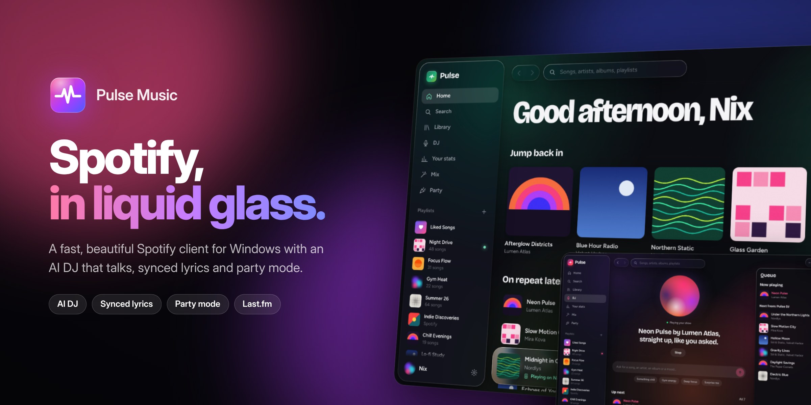
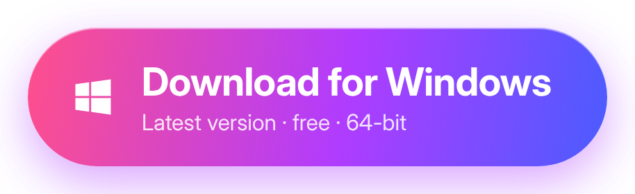
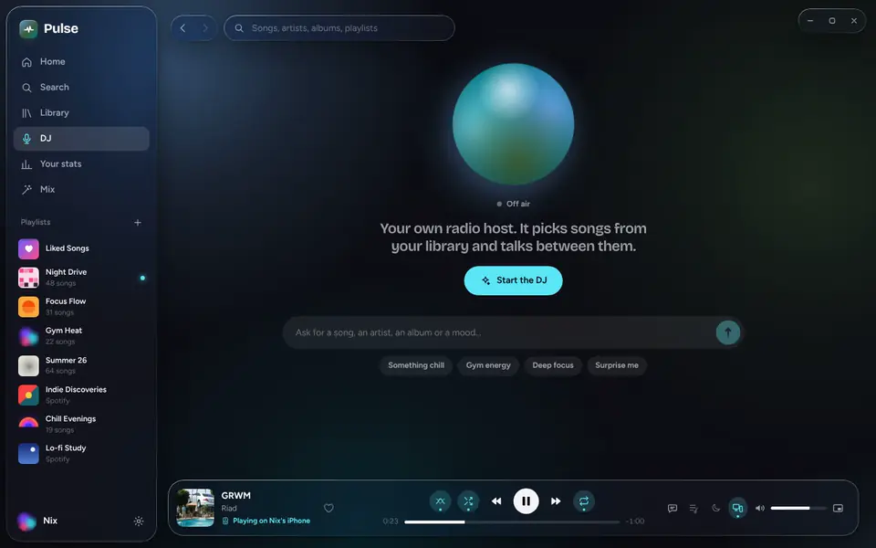
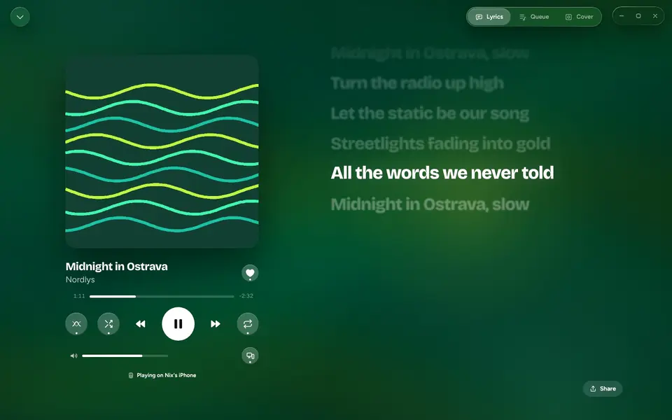
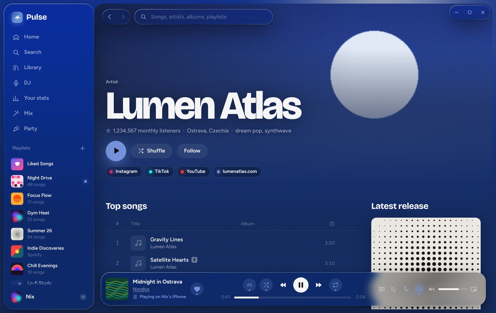
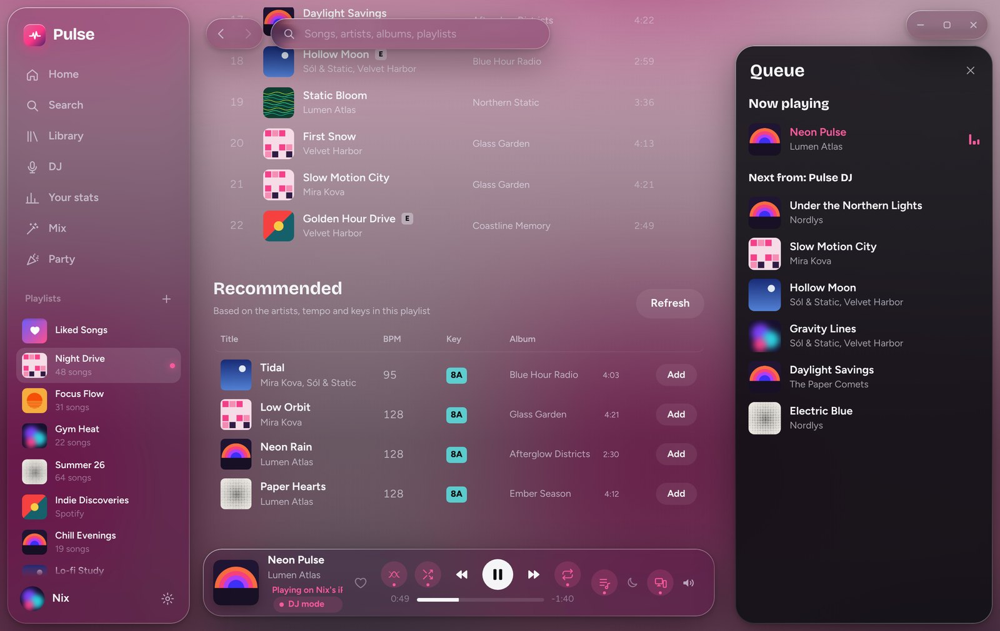
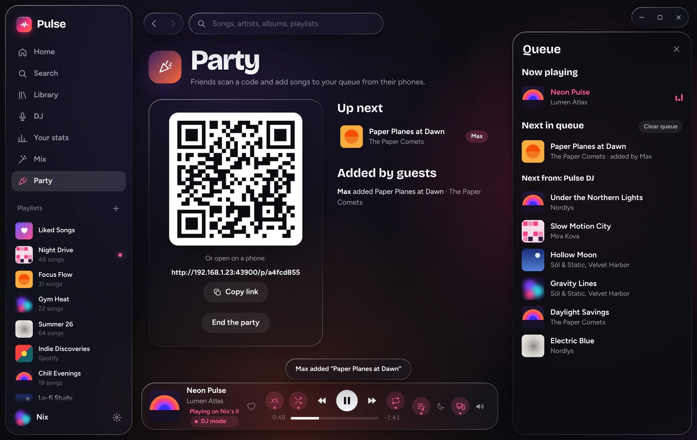
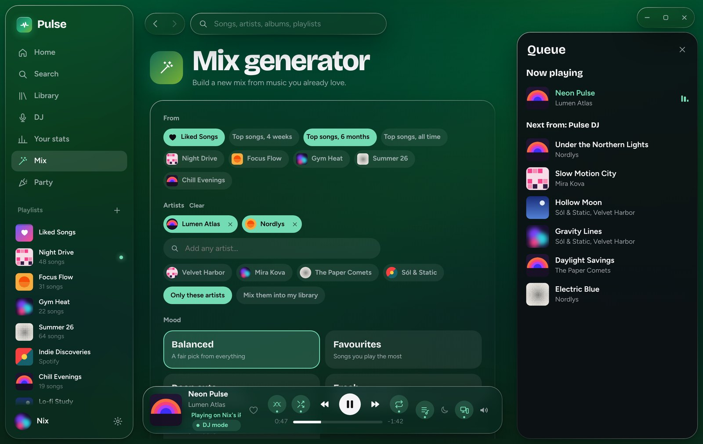
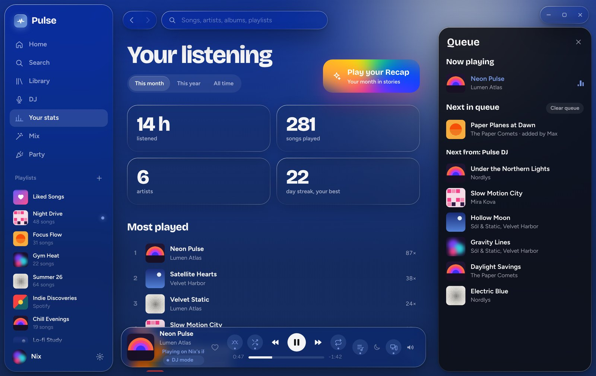
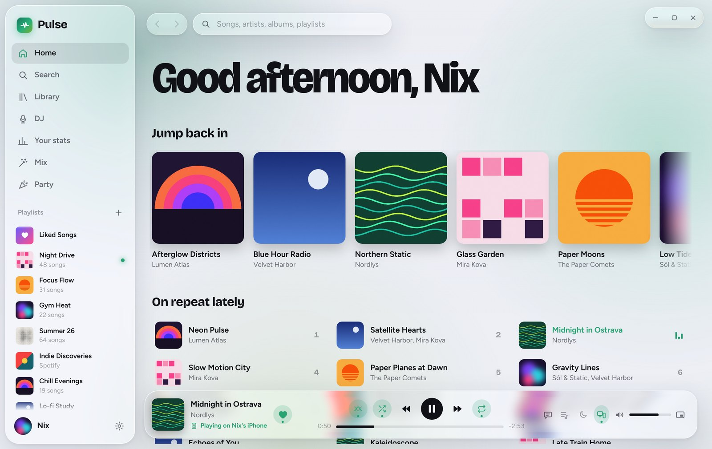

  

  

  
  
  
  

  <b>Your Spotify, rebuilt with frosted glass, colours that follow the music and an AI DJ that talks to you.</b> 
  The app updates itself, so you only download it once.

 

## ✨ What's inside

<table>
  <tr>
    <td width="50%" valign="top">
      
      <h3>🎙️ An AI DJ that talks</h3>
      Type <i>"play phonk"</i> or <i>"something by Porsche Boy"</i>. The DJ builds a set, keeps to your vibe, switches genre every few songs and tells you about it in a real voice.
    </td>
    <td width="50%" valign="top">
      
      <h3>🎤 Word-by-word lyrics</h3>
      Full-screen lyrics that light up word by word, on a background that takes its colours from the album cover.
    </td>
  </tr>
  <tr>
    <td valign="top">
      
      <h3>🎨 Artist pages in full resolution</h3>
      Sharp header images, popular songs in Spotify's order, albums, EPs, singles, socials and the story behind the artist.
    </td>
    <td valign="top">
      
      <h3>🧭 Smarter recommendations</h3>
      Open a playlist and get songs that actually fit, matched by artist, tempo (BPM) and key. One click adds them.
    </td>
  </tr>
  <tr>
    <td valign="top">
      
      <h3>🎉 Party mode</h3>
      Friends scan a QR code and add songs from their phones. Nothing to install, and everyone has a fair limit.
    </td>
    <td valign="top">
      
      <h3>🎛️ Mix generator</h3>
      Pick any artists, a mood and a length, and Pulse makes the playlist for you.
    </td>
  </tr>
  <tr>
    <td valign="top">
      
      <h3>📊 Your stats and Recap</h3>
      Listening time, top songs and artists, plus a story-style Recap you can share.
    </td>
    <td valign="top">
      
      <h3>🌗 Light and dark</h3>
      Follows Windows, or pick your own. Also has Last.fm scrobbling, Discord status, a sleep timer and a mini player.
    </td>
  </tr>
</table>

 

## 🚀 Get started in 3 steps

| | |
|:-:|:--|
| **1** | **[Download `PulseMusic-Setup.exe`](https://github.com/Nixinak/pulsemusic-releases/releases/latest/download/PulseMusic-Setup.exe)** and open it. |
| **2** | If Windows says *"Windows protected your PC"*, click **More info → Run anyway**. The app is safe, it just isn't signed with a paid certificate. |
| **3** | Choose whether to install the **AI DJ** (about 5 GB, can also be added later from the DJ page), then sign in with Spotify. |

> [!IMPORTANT]
> You need **Spotify Premium**, and the app is in Spotify's developer mode, so **Nix has to add your Spotify account first**. Send him the email you use for Spotify before you sign in.

 

## ❓ FAQ

<b>Do I need any API keys or accounts?</b>

 
No. Everything is built in. You only sign in with Spotify. Last.fm is optional and connects in one click.

<b>How do updates work?</b>

 
Pulse checks this page in the background. When a new version is ready you get a small "Restart now" button, or it installs itself the next time you close the app.

<b>The AI DJ doesn't answer.</b>

 
The DJ runs on your own PC with Ollama. Open the <b>DJ</b> page (or Settings) and click <b>Set up the AI DJ for me</b>; it downloads everything it needs. The first answer can take a few seconds.

<b>Sign-in says I'm not allowed.</b>

 
Your Spotify account hasn't been added yet. Ask Nix to add the email of your Spotify account.

<b>Is it free?</b>

 
Yes. Pulse Music is a free fan project and is not affiliated with Spotify.

 

  
   
  Made with ♥ by Nix · <a href="https://github.com/Nixinak/pulsemusic-releases/releases">All versions</a>

