

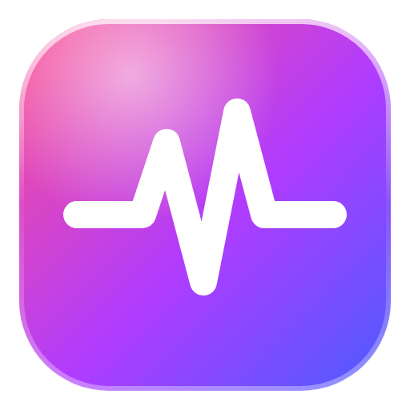

# Pulse Music

**Spotify, in liquid glass.** 
A free Spotify app for Windows with an AI DJ that talks, word-by-word lyrics and party mode.

<a href="https://nixinak.github.io/pulsemusic-releases/"><b>Website</b></a> &nbsp;•&nbsp;
<a href="https://github.com/Nixinak/pulsemusic-releases/releases/latest/download/PulseMusic-Setup.exe"><b>Download</b></a> &nbsp;•&nbsp;
<a href="#-features"><b>Features</b></a> &nbsp;•&nbsp;
<a href="#-install"><b>Install</b></a> &nbsp;•&nbsp;
<a href="#-faq"><b>FAQ</b></a>

 

  

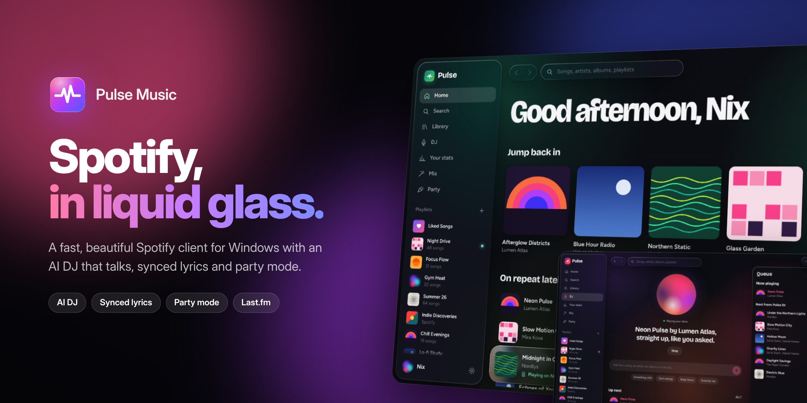

  

<a href="https://github.com/Nixinak/pulsemusic-releases/releases/latest/download/PulseMusic-Setup.exe">
  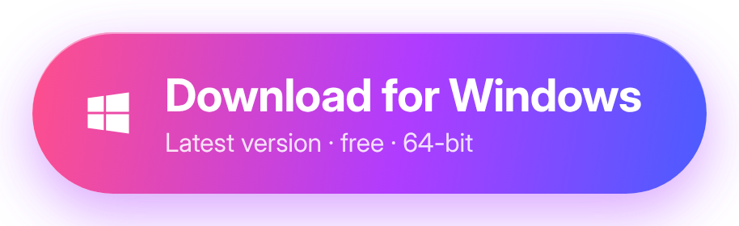
</a>

Installs in seconds and updates itself, so you only download it once.

 

## ✨ Features

### 🎙️ An AI DJ that talks between songs

Tell it what you're in the mood for, like *"play phonk, but not too hard"* or *"something by Porsche Boy"*. It builds a set, keeps to your vibe, switches genre every few songs and introduces the next one in a natural voice. Everything runs on your own PC, for free.

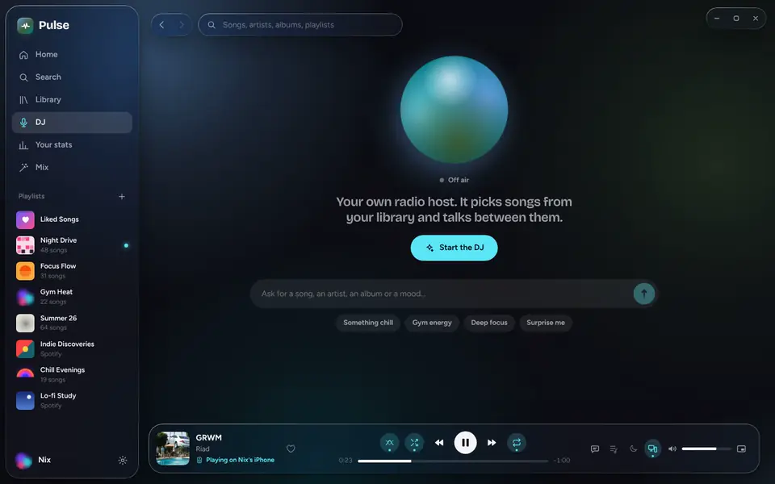

### 🎤 Lyrics that follow every word

Full-screen synced lyrics light up word by word on a background painted from the album cover. Or dock them at the side while you keep browsing.

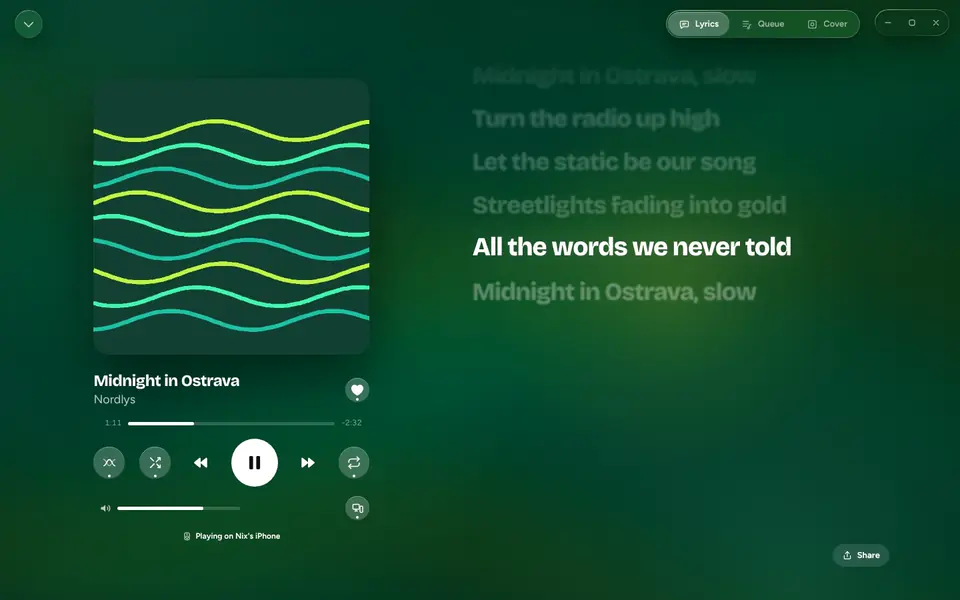

### And there's more

<table>
  <tr>
    <td width="50%" valign="top">
      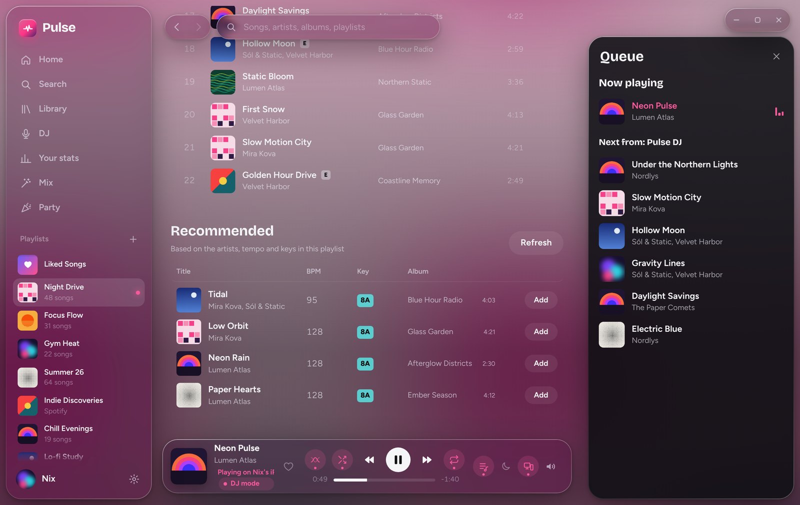
      <h4>🧭 Recommendations that fit</h4>
      Songs matched by artist, tempo (BPM) and key under every playlist. Press play and they keep going, then autoplay carries on with music like it.
    </td>
    <td width="50%" valign="top">
      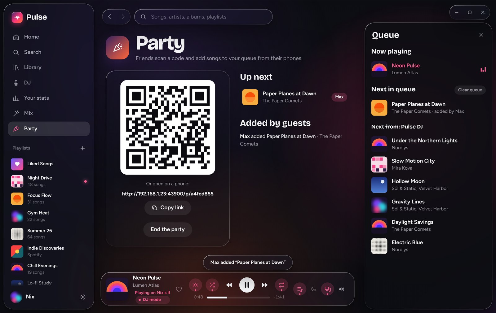
      <h4>🎉 Party mode</h4>
      Friends scan a QR code or open a link and add songs from their phones. Nothing to install, and everyone gets a fair limit.
    </td>
  </tr>
  <tr>
    <td valign="top">
      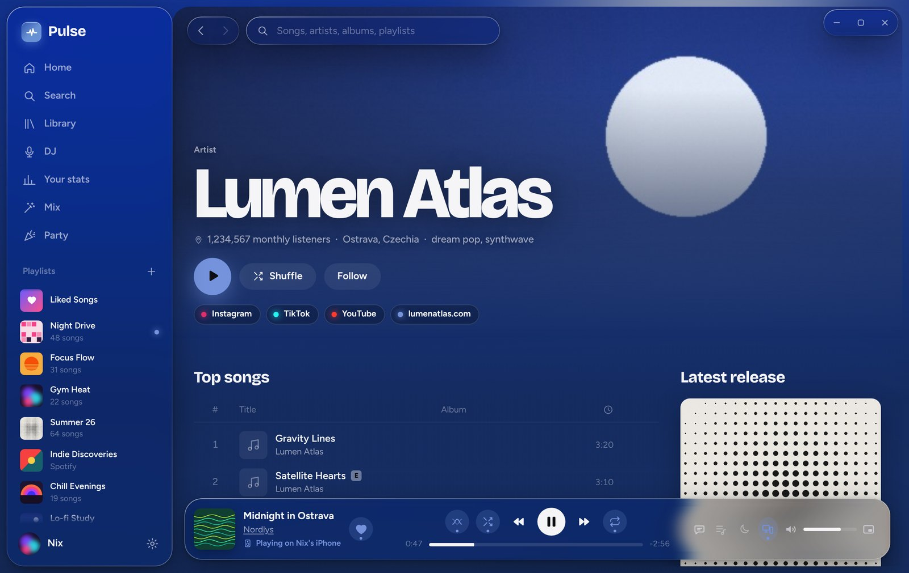
      <h4>🎨 Artist pages in full resolution</h4>
      Sharp header images, popular songs, the whole discography, socials and the story behind the artist.
    </td>
    <td valign="top">
      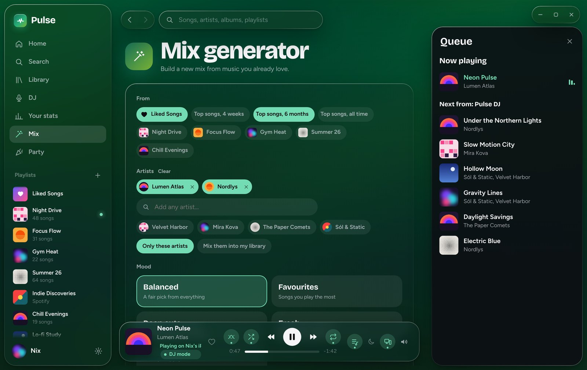
      <h4>🎛️ Mix generator</h4>
      Pick a few artists, a mood and a length, and Pulse makes the playlist for you.
    </td>
  </tr>
  <tr>
    <td valign="top">
      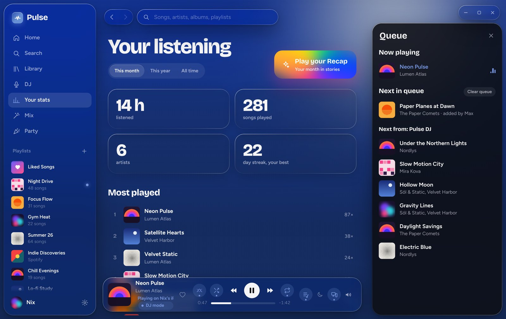
      <h4>📊 Your stats and Recap</h4>
      Listening time, top songs and artists, plus a story-style Recap you can share.
    </td>
    <td valign="top">
      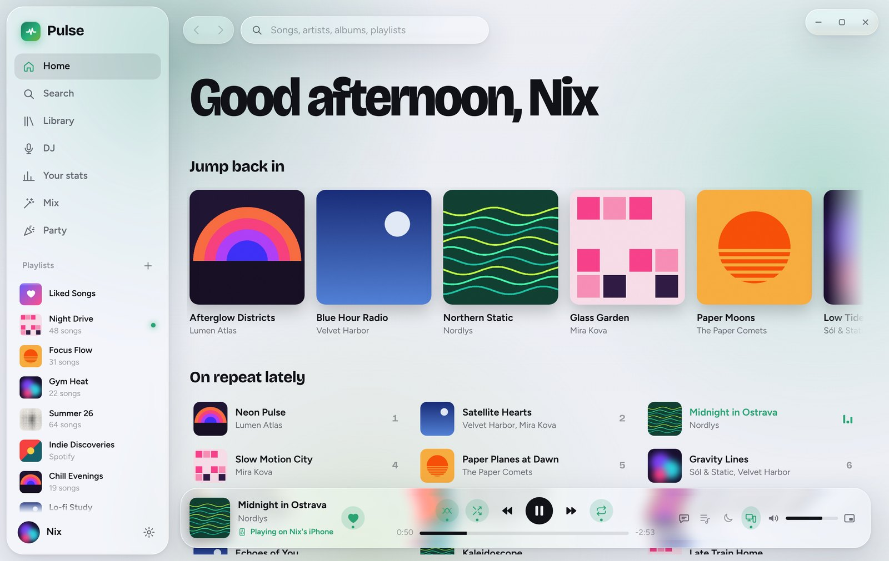
      <h4>🌗 Light and dark</h4>
      Follows Windows, or pick your own theme, background palette and font.
    </td>
  </tr>
</table>

<b>Everything else in the box</b>

 

| | |
|:--|:--|
| 🎨 **Colours that follow the music** | The whole app takes its colours from the album cover that's playing. |
| 🔁 **Autoplay** | When a song, album or playlist ends, similar music keeps playing. |
| 📋 **A real queue** | Reorder, remove and clear songs, which Spotify's own API doesn't allow. |
| 🌊 **Song transitions** | Optional fades between songs with both covers on screen (Settings → Playback). |
| 💬 **Discord status** | Shows what you're listening to, and "Paused" when you pause. |
| 📻 **Last.fm** | Scrobbling in one click. |
| 😴 **Sleep timer** | Stop after a set time or at the end of the song. |
| 🪟 **Mini player** | A small always-handy window for the current song. |
| 📱 **Spotify Connect** | Pulse shows up as a device, and it can control your phone or speaker too. |
| ⬆️ **Updates itself** | New versions download in the background. |

 

## 🚀 Install

| | |
|:-:|:--|
| **1** | **[Download `PulseMusic-Setup.exe`](https://github.com/Nixinak/pulsemusic-releases/releases/latest/download/PulseMusic-Setup.exe)** and open it. |
| **2** | If Windows says *"Windows protected your PC"*, click **More info → Run anyway**. The app is safe, it just isn't signed with a paid certificate. |
| **3** | Choose whether to add the **AI DJ** (about 5 GB, you can also add it later from the DJ page), then sign in with Spotify. |

> [!NOTE]
> You need **Spotify Premium**. Spotify only lets a few accounts into each app, so if it doesn't let you in, the sign-in screen walks you through making your own free Spotify app key. It takes about two minutes.

 

## ❓ FAQ

<b>Is it free?</b>

 
Yes. Pulse Music is a free fan project. You need your own Spotify Premium account, because Spotify only lets Premium accounts play music in other apps.

<b>Will my playlists and likes be there?</b>

 
Yes. Pulse signs in to your Spotify account, so everything you change shows up in Spotify on your phone too, and the other way round.

<b>How do updates work?</b>

 
Pulse checks this page in the background. When a new version is ready you get a small "Restart now" button, or it installs itself the next time you close the app.

<b>The AI DJ doesn't answer.</b>

 
The DJ runs on your own PC with Ollama. Open the <b>DJ</b> page (or Settings) and click <b>Set up the AI DJ for me</b>; it downloads everything it needs. The first answer can take a few seconds.

<b>Do I need any API keys?</b>

 
No. Everything is built in. Last.fm is optional and connects in one click.

<b>Is there a Mac or phone version?</b>

 
Not yet. Pulse Music is made for Windows 10 and 11.

 

## 💜 Thanks

Pulse Music stands on the shoulders of [Spotify's Web API](https://developer.spotify.com/), [LRCLIB](https://lrclib.net/) and [Genius](https://genius.com/) for lyrics, [Deezer](https://developers.deezer.com/) for similar artists, [Ollama](https://ollama.com/) and [Kokoro](https://huggingface.co/hexgrad/Kokoro-82M) for the DJ's brain and voice, and [Electron](https://www.electronjs.org/) with [React](https://react.dev/).

 

Made with ♥ by Nix &nbsp;•&nbsp; <a href="https://github.com/Nixinak/pulsemusic-releases/releases">All versions</a> &nbsp;•&nbsp; Not affiliated with Spotify

